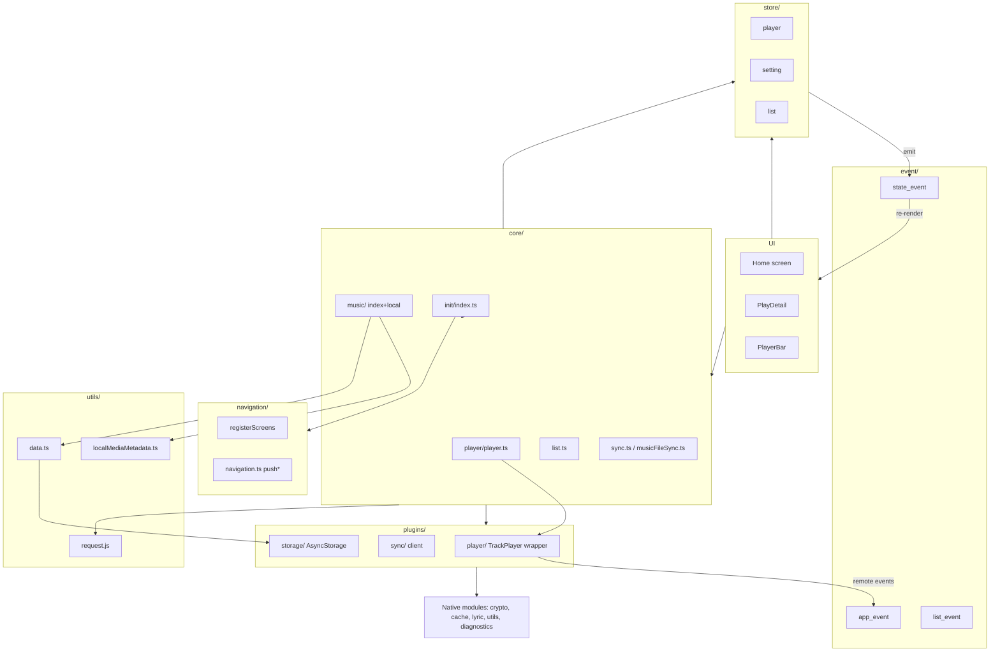
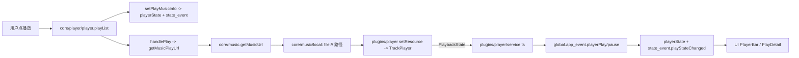
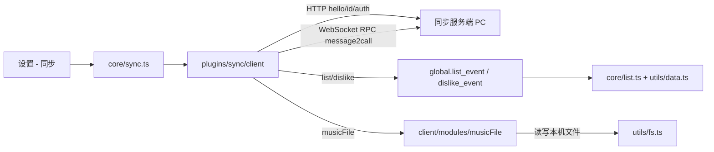

# ARCHITECTURE

## 高层形态

**分层 + 模块单例**架构。没有 Redux。业务逻辑在 `src/core`（纯 TS，无 React），状态在 `src/store`
的按域单例对象里。React 屏幕/组件通过各域 `hook.ts` 读取状态（hook 订阅全局事件发射器）。
UI 操作调用 `core` 函数 → 修改单例状态 → 发射事件 → 订阅的 hook 重渲染。

关键结果：**数据不通过 props/context 自上而下流动**，而是走「模块单例 + `global.state_event`」。

## 分层

```
screens / components (React)
   │ 读: store/*/hook.ts         │ 调: core/*
   ▼                             ▼
store/* (单例状态+action)      core/* (业务逻辑)
   │ mutate + emit               │ 调
   ▼                             ▼
event/* (state/app/list/dislike) utils/* + plugins/* (player/sync/storage/request)
                                 │
                                 ▼
                       原生模块(Android Java) / 网络 / FS / AsyncStorage
```

## 状态管理（必须先理解）

`src/store/<domain>/` 三件套：
- `state.ts` — **模块级单例对象**（`const state = {...}`），全项目共享同一引用
- `action.ts` — 修改 `state` 字段后调用 `global.state_event.xxx()`（需要持久化时调 `utils/data.ts`）
- `hook.ts` — React hooks（`useState` + `useEffect` 订阅事件），返回当前值并在事件触发时重渲染

事件发射器 `src/event/Event.ts` 用 `setImmediate` 异步派发；`src/event/stateEvent.ts` 定义全部类型化事件。
`global.lx`、`global.state_event`、`global.app_event`、`global.list_event`、`global.dislike_event`
都在 `src/config/globalData.ts` **import 时**创建。

> 新增共享数据：在所属域 `state.ts` 加字段 → 加 action（改值 + emit）→ 在 `stateEvent.ts` 加事件 →
> 加 hook。不要新造全局变量。

## 依赖方向

- `screens/components` → `store`（hook）+ `core`（action）+ `navigation`
- `core` → `store` + `utils` + `plugins` + `config`
- `store` → `config` + `utils`（持久化）+ `event`
- `plugins/player` → `core/player`（遥控/事件桥接，**设计上的循环**，保持函数级引用，避免模块求值副作用）
- `utils` 应是叶子；`core` 保持无 UI 依赖

## Mermaid — 总体



## Mermaid — 播放状态流



## 跨平台结构

- 共享 TS；平台差异靠 `babel.config.js` 的扩展名解析顺序（`foo.android.ts` 优先于 `foo.ts`）。
  目前 `src` 里以 `isAndroid` / `Platform.OS` 守卫为主，没有实际使用 `.android.ts` 分文件。
- Android 原生模块在 `android/app/src/main/java/cn/toside/music/mobile/`：
  `crypto`、`cache`、`lyric`（悬浮歌词）、`utils`、`diagnostics`（`userApi` 已随功能删除）。
- `src/utils/nativeModules/*` 包装 `NativeModules` / `NativeEventEmitter`。

## 线程 / 后台

- `react-native-track-player` 原生播放引擎；事件经 `plugins/player/service.ts` 回传。
- 后台定时器用 `react-native-background-timer`（重试、下一首延迟、超时退出）。
- 没有 JS Worker / web worker。
- 本地文件解析（元数据、封面、歌词）在 `utils/localMediaMetadata.ts`（原生库）+ JS 侧兜底。

## Mermaid — 同步



## 与上游关系

已 fork 并精简，**不合并上游**；上游修复按需手工判断（多数与在线功能相关，可跳过）。
